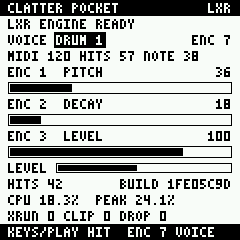

# CLATTER Pocket

**CLATTER's LXR-02 drum synthesis as custom firmware for the M-VAVE FM-1.**

CLATTER Pocket brings [CLATTER](https://github.com/clickysteve/clatter), the generative drum
synthesizer built on the Erica Synths LXR-02's open-source sound engine, to the M-VAVE FM-1
pocket synthesizer, through M-VAVE's open firmware SDK
([fm1_open](https://github.com/m-vave/fm1_open)).

> CLATTER Pocket is an independent project. It is **not** an Erica Synths or M-VAVE product
> and is not endorsed by either. It contains a modified version of the LXR-02 firmware's
> sound engine. "Erica Synths", "LXR" and "LXR-02" are trademarks of Erica Synths; "M-VAVE"
> and "FM-1" of their owner.

## Status

| | |
|---|---|
| LXR engine (all six voices, seven triggers, the firmware's parameter handler, modulation, locks) | runs natively; 177 host checks pass; matches CLATTER's engine to within 3 LSB; the FM-1's packed tables unpack byte-identical |
| FM-1 firmware, CLATTER Pocket **replacing** the stock instrument application | **builds and packages** reproducibly with the FM-1 toolchain: 437,436-byte image (16,485 bytes under the 453,921 limit, 101 over the 16 KB margin), stock flash layout, all SDK firmware checks pass, user partition untouched, installer page ([FM1-REPLACEMENT.md](FM1-REPLACEMENT.md)) |
| Pre-flash audit | done ([PRE-FLASH-AUDIT.md](PRE-FLASH-AUDIT.md)); first-test procedure: [FIRST-HARDWARE-TEST.md](FIRST-HARDWARE-TEST.md) |
| On the device | **1.0.0 is hardware verified** on the owner's FM-1: installed over earlier firmware and from stock V15, reporting its own identity `FM-1_8133700`, left for V15 and installed again ([report](https://github.com/clickysteve/clatter-pocket/issues/2)). The same firmware, as 0.9.4, passed start-up, audio, the keys and sequencer, MIDI notes and clock over USB, saving and loading after power-off, GLOBAL's settings, clearing and copying patterns ([report](https://github.com/clickysteve/clatter-pocket/issues/1)), after 0.9.0 passed USB audio. One unit. Not recorded: SAFE MODE, Bluetooth, DIN MIDI, long runs. Results: [FIRST-HARDWARE-TEST.md](FIRST-HARDWARE-TEST.md) |
| Website | <https://clatter-pocket.allmyfriendsaresynths.com/>: browser demo, and the installer for the hardware-verified 1.0.0 release ([docs/WEBSITE.md](docs/WEBSITE.md)). It takes any `ota-` update loader, since one unit came back from the handover as `ota-FM1C_0000000000000000`. Releases: [GitHub](https://github.com/clickysteve/clatter-pocket/releases) |
| Sequencer and generator | 64 steps on four pages, seven tracks with notes, variations and conditional steps, CLATTER's styles, whole-pattern and one-track generation, mutation; **tested in the FM-1 emulator** ([docs/POCKET-SEQUENCER.md](docs/POCKET-SEQUENCER.md)) |
| Playing it | three banks of nine sounds and a PITCH keyboard, live and step recording, one undo and redo of everything, 16 kits and on-device kit generation from LXR parameters, GLOBAL settings; **tested in the FM-1 emulator** ([docs/POCKET-CONTROLS.md](docs/POCKET-CONTROLS.md)) |
| Saving | 9 projects, kit and pattern together, in user Flash, written only to sectors checked blank or its own; **works on one device**, and tested on a model of the chip and in the FM-1 emulator ([docs/POCKET-STORAGE.md](docs/POCKET-STORAGE.md)) |

## What it does on the FM-1 (once installed)

In the replacement firmware CLATTER Pocket is the instrument: the panel below about 1.5 s
after power-on (hold HOME then for SAFE MODE, engine off), MIDI notes play as the keys do, and USB/Bluetooth audio is mixed in as before.

| Control | Action |
|---|---|
| note keys | DRUM: three banks of the same nine sounds. PITCH: the selected voice, chromatically (SEL switches). **On SEQ, the pattern:** white keys are a page of steps, the first four black keys the pages, held steps edited with the knobs, SEQ+REC clears it |
| OCT− / OCT+ | PITCH: octave. DRUM: how hard the keys hit. On SEQ: page. Held SAVE: undo, redo |
| PLAY, REC | start or stop; recording on or off |
| ENV, ARP, LFO | a new kit, a new pattern, mutate. Held SAVE: the selected voice only |
| PRESETS, ALGORITHM | the kit, the pattern style |
| SAVE, a tap | PROJECTS: choose a slot with SELECT, tap SAVE to store, OCT+ to load, OCT− to erase |
| SAVE+FX | lock the selected track |
| SELECT | select DRUM 1-3, SNARE, CYMBAL, CL HAT, OP HAT |
| HOME, SEQ, EDIT, FX, GLO | pages: MAIN, PATTERN, SOUND, MIXER, GLOBAL then SYSTEM |
| KNOB 1-4 | PATTERN: velocity, tempo, swing, step; held SAVE: condition, page; held SEQ: length. SOUND: pitch, decay, filter, drive. MIXER: level, pan. GLOBAL: row, value |
| MASTER | master volume (stock) |

**[docs/POCKET-CONTROLS.md](docs/POCKET-CONTROLS.md) is the guide to playing it**, with a quick start.
docs/POCKET-UI.md has the interface, how to load it in the FM-1 emulator, and its results. The encoder positions come from the emulator and have not been checked one by one on a device.



## Quick start (host)

```
git clone --recurse-submodules https://github.com/clickysteve/clatter-pocket
cd clatter-pocket
make                 # tests
make render          # build/host/kick_sweep.wav, kit_demo.wav
make bench
make compare CLATTER_DIR=../clatter
```

Firmware: BUILDING.md. **Read HARDWARE.md before flashing anything.**

## Documents

- [HARDWARE.md](HARDWARE.md) - the FM-1 and its SDK: verified facts, sources, update and
  recovery, open questions
- [BUILDING.md](BUILDING.md) - host and firmware builds, toolchain
- [ARCHITECTURE.md](ARCHITECTURE.md) - layers, real-time design, porting decisions, CPU and memory
- [COMPATIBILITY.md](COMPATIBILITY.md) - numerical comparison with CLATTER, kits, formats
- [FM1-REPLACEMENT.md](FM1-REPLACEMENT.md) - the replacement firmware: flash map, what was
  removed, what remains, sizes, RAM, checks
- [PRE-FLASH-AUDIT.md](PRE-FLASH-AUDIT.md) - the pre-flash audit: findings, evidence, risks
- [FIRST-HARDWARE-TEST.md](FIRST-HARDWARE-TEST.md) - first installation, test and recovery
- [ROADMAP.md](ROADMAP.md) - milestones A-F
- [docs/WEBSITE.md](docs/WEBSITE.md) - the website, its browser demo, and how a release enables installing
- [docs/FM1-COMMUNITY.md](docs/FM1-COMMUNITY.md) - how FM-1 firmware is distributed, updated and recovered

## Layout

```
lxr/              LXR-02 firmware DSP (unchanged) + CLATTER's shim and bridge
engine/           real-time engine host (event ring, mixing, Q23 output)
ui/               the Pocket panel (platform-independent)
host/             tests, benchmark, WAV renderer, CLATTER comparison
firmware/fm1/     FM-1 application (replace/: the app and its fm1_open patch), build scripts
third_party/      fm1_open (submodule, pinned)
tools/            generators, toolchain setup, size estimate, website build
site/             the website (docs/WEBSITE.md)
```

## Licence

GPL-3.0-only with the LXR firmware's additional terms (NOTICE.md). Firmware builds also
link M-VAVE's binary SDK under its own terms and the fm1_open linking exception
(THIRD_PARTY_NOTICES.md).
