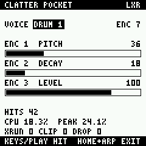

# CLATTER Pocket

**CLATTER's LXR-02 drum synthesis as custom firmware for the M-VAVE FM-1.**

CLATTER Pocket brings [CLATTER](https://github.com/clickysteve/clatter), the generative drum
synthesizer built on the Erica Synths LXR-02's open-source sound engine, to the M-VAVE FM-1
pocket synthesizer, through M-VAVE's open firmware SDK
([fm1_open](https://github.com/m-vave/fm1_open)).

> CLATTER Pocket is an independent project. It is **not** an Erica Synths or M-VAVE product
> and is not endorsed by either. It contains a modified version of the LXR-02 firmware's
> sound engine. "Erica Synths", "LXR" and "LXR-02" are trademarks of Erica Synths; "M-VAVE"
> and "FM-1" of their owner.

## Status

| | |
|---|---|
| LXR engine (all six voices, seven triggers, the firmware's parameter handler, modulation, locks) | runs natively; 65 host checks pass; matches CLATTER's engine to within 3 LSB |
| FM-1 integration (audio hook, panel, timing display) | written, patch applies, type-checks against the SDK; **not compiled with the FM-1 toolchain yet** |
| On the device | **nothing has run on hardware** |
| Sequencer, generation, storage | not started (ROADMAP.md) |

## What it does on the FM-1 (once built)

The stock instrument keeps working. **HOME + ARP** opens CLATTER Pocket:

| Control | Action |
|---|---|
| note keys | play the selected LXR voice chromatically (13th key = programmed pitch) |
| PLAY | play the selected voice |
| encoder 1 / 2 / 3 | pitch / decay / level of the selected voice |
| encoder 7 | select DRUM 1-3, SNARE, CYMBAL, CL HAT, OP HAT |
| MASTER | master volume (stock) |
| HOME + ARP | back to the stock instrument (voices ring out) |

The screen shows the engine's CPU share per audio block (mean and peak), DMA overruns,
clipped samples and dropped events. Encoder numbering is the SDK's; the physical knobs are
still to be identified.



## Quick start (host)

```
git clone --recurse-submodules https://github.com/clickysteve/clatter-pocket
cd clatter-pocket
make                 # tests
make render          # build/host/kick_sweep.wav, kit_demo.wav
make bench
make compare CLATTER_DIR=../clatter
```

Firmware: BUILDING.md. **Read HARDWARE.md before flashing anything.**

## Documents

- [HARDWARE.md](HARDWARE.md) - the FM-1 and its SDK: verified facts, sources, update and
  recovery, open questions
- [BUILDING.md](BUILDING.md) - host and firmware builds, toolchain
- [ARCHITECTURE.md](ARCHITECTURE.md) - layers, real-time design, porting decisions, CPU and memory
- [COMPATIBILITY.md](COMPATIBILITY.md) - numerical comparison with CLATTER, kits, formats
- [ROADMAP.md](ROADMAP.md) - milestones A-F

## Layout

```
lxr/              LXR-02 firmware DSP (unchanged) + CLATTER's shim and bridge
engine/           real-time engine host (event ring, mixing, Q23 output)
ui/               the Pocket panel (platform-independent)
host/             tests, benchmark, WAV renderer, CLATTER comparison
firmware/fm1/     FM-1 adapter, fm1_open patch, build scripts
third_party/      fm1_open (submodule, pinned)
tools/            generators, toolchain setup, size estimate
```

## Licence

GPL-3.0-only with the LXR firmware's additional terms (NOTICE.md). Firmware builds also
link M-VAVE's binary SDK under its own terms and the fm1_open linking exception
(THIRD_PARTY_NOTICES.md).
