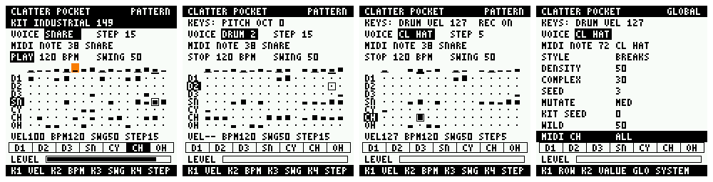

# Playing CLATTER Pocket

The FM-1's own controls, as a generative drum machine: two keyboard modes, recording, kits and
rhythms made on the device. **Tested on the host and in the FM-1 emulator. Nothing here has run on a
device; the firmware stays UNVERIFIED.**



## Quick start

In the [browser emulator](https://joakimeriksson.github.io/fm1-emu/) at 240 MHz (loading it:
[POCKET-UI.md](POCKET-UI.md)). The computer key for each control is in brackets; the knobs have
none, so use the mouse.

1. **Generate a kit.** Press ENV `3`. The status line says GENERATING KIT, then the kit's name and
   seed. To choose a character first, turn PRESETS `↑ ↓`.
2. **Generate a pattern.** Press ARP `9`. ALGORITHM `, .` chooses the style first, if you want one.
3. **Press PLAY** `Space`. Leave it running: everything below works while it plays.
4. **Switch keyboard modes.** SCL `2` changes KEYS: DRUM to KEYS: PITCH. In DRUM, the keys `A W S E D`
   are kick, snare, snare, closed hat, open hat. In PITCH every key plays the selected voice, and
   OCT− `Z` and OCT+ `X` change the octave.
5. **Record notes.** Press REC `R`. Playing, what you hit lands on the nearest step. Stopped, what
   you hit lands on the selected step, and hitting it again removes it.
6. **Edit the pattern.** SEQ `0` opens PATTERN. KNOB 4 moves the selected step, KNOB 1 sets its
   velocity, KNOB 2 the tempo, KNOB 3 the swing.
7. **Regenerate one instrument.** Turn SELECT `← →` to a voice, or hit its key. **Hold SAVE `8`** and
   press ENV `3` for a new sound, or ARP `9` for a new rhythm. The rest stays as it was.
8. **Mutate the rhythm.** LFO `4` varies the pattern; hold SAVE and press LFO for one track only.

SAVE+OCT− `8`+`Z` undoes the last change to the pattern, and SAVE+OCT+ `8`+`X` the last change of kit.

## Control map

Every control below works on every page, unless it says otherwise.

| Control | Action | Held SAVE + it |
|---|---|---|
| **Keys** | play: DRUM or PITCH, below | |
| **SCL** | KEYS: DRUM or KEYS: PITCH | |
| **OCT− / OCT+** | PITCH: octave, −3 to +3. DRUM: how hard the keys hit, 40, 70, 100 or 127 | OCT−: undo the pattern. OCT+: undo the kit. Again, redo |
| **PLAY** | start or stop | |
| **REC** | recording on or off | |
| **ENV** | a new kit, in the character PRESETS chose | a new sound for the selected voice |
| **ARP** | a new pattern, in the style ALGORITHM chose | a new pattern for the selected track |
| **LFO** | mutate the pattern, at GLOBAL's MUTATE strength | mutate the selected track |
| **SAVE** | a tap locks or unlocks the selected track: ARP and LFO leave it alone | |
| **SELECT** | the selected voice | |
| **PRESETS** | the kit: INIT, then 16 characters | |
| **ALGORITHM** | the pattern style, of 11 | |
| **HOME SEQ EDIT FX** | MAIN, PATTERN, SOUND, MIXER | |
| **GLO** | GLOBAL; again, SYSTEM | |
| **MASTER** | output level | |
| HOME held at 1.5 s after power-on | SAFE MODE, unchanged | |

| Knob | PATTERN | SOUND | MIXER | GLOBAL |
|---|---|---|---|---|
| KNOB 1 | selected step's velocity | pitch | level | row |
| KNOB 2 | tempo | decay | pan | value |
| KNOB 3 | swing | filter | | |
| KNOB 4 | selected step | drive | | |

Lights: PLAY playing, REC recording, SCL in PITCH, SAVE on a locked track.

### The FM-1 is not what was asked for in one respect

**SELECT cannot be held.** It is a rotary encoder with no switch: the SDK reports 14 buttons, 27 keys
and 7 encoders, and an encoder is two contacts (`fm1_input.h`, `struct fm1_controls`). So every "hold
SELECT" in the brief is **hold SAVE** here. SAVE was the button with the least to lose: a tap still
locks, on release, and a chord never does. On a track that is locked, SAVE+ARP and SAVE+LFO refuse and
say so. The footer shows the chord while SAVE is down.

**The keys have no velocity.** The scanner reports on and off, nothing else (`fm1_scan_decode`; the
emulator's `fm1_velocity` is for another board, the SMK-37). So the keys play at one level that you
set, with OCT in DRUM or KEY VEL on GLOBAL. MIDI notes keep their own velocity.

### What moved, and where it went

| Was | Now |
|---|---|
| OCT− / OCT+ changed the page | the page buttons; every page has one |
| REC toggled the selected step | keys, with REC on and stopped. There is no longer a way to turn a step off while playing: stop first, or use SAVE+ARP |
| ALGORITHM moved the step | KNOB 4 |
| SCL put the knobs on the generator | GLOBAL has DENSITY, COMPLEX, SEED and MUTATE. The style is on ALGORITHM |
| KNOB 4 set the mutation strength | GLOBAL's MUTATE |
| ENV undid the pattern | SAVE+OCT− |
| The buttons acted on PATTERN only | on every page: you can generate from SOUND. Each change has its undo |
| Keys played the selected voice; the 13th key (F4) was the programmed pitch | DRUM at start-up. In PITCH, **C4** is the programmed pitch, which is what the engine calls note 60 |

## The keyboard

### DRUM

A key is an instrument, the same at every octave, and every key plays. Instruments play at their
programmed pitch, whatever the key's position.

| Key | C | C# | D | D# | E | F | F# | G | G# | A | A# | B |
|---|---|---|---|---|---|---|---|---|---|---|---|---|
| Plays | kick | snare | snare | closed hat | open hat | low tom | high tom | cymbal | high tom | cymbal | closed hat | kick |
| Track | D1 | SN | SN | CH | OH | D2 | D3 | CY | D3 | CY | CH | D1 |
| CLATTER's role | kick | snare | clap | closed hat | open hat | low tom | high tom | cymbal | perc | fx | | |

The LXR has **six voices and seven triggers**, not ten instruments. The ten keys of the brief are in
the places it asked for, folded into seven tracks as CLATTER's default project routes them. So
**the clap, percussion and FX keys play the same sound as the snare, high tom and cymbal**. A# and B
give a second hat and kick, for two-finger rolls. Whether SN is a snare or a clap is the kit's choice,
and likewise whether D3 is a tom or a percussion voice.

OCT sets the keys' velocity rather than switching banks: all seven instruments fit in one octave, so
a bank would have nothing to do.

With FOLLOW on (the default), the selected voice follows the last DRUM key or MIDI note, so a hit
selects what SAVE+ENV and SAVE+ARP act on. SCL never changes it.

### PITCH

Every key plays the selected voice, chromatically: key F3 is MIDI note 53 and G5 is 79, plus 12 for
each octave. The hit carries the note to the engine, which is the LXR's own `osc_setBaseNote(note)`,
`coarse + note − 60`, per trigger. **No parameter is written**, so nothing can accumulate and the
patch does not change: in the emulator, 97 Hz, an octave up 192 Hz, and 97 Hz again after six octave
presses. On COARSE-tuned voices the pitch is the oscillator's: **the snare's noise does not transpose**
(an upstream TODO), and the hats' and cymbal's noisy modulators follow their oscillators but are not
tonal.

### MIDI

Note-ons take the same path as the keys, so they play and record the same way, at their own velocity.
In PITCH, a note plays the selected voice. In DRUM, the General MIDI drum notes play their voices, or
with MIDI MAP on KEYS, the keys' map above.

## Recording

REC is a mode: `REC ON` on the status line and the REC light. Off, the keys record nothing.

Each step is one aligned 16-bit cell:

```c
uint16_t cell[7][16]; /* low byte: velocity (0 off). High byte: 0 the programmed pitch, or the MIDI note */
```

A step's velocity and note change in one write, so the audio interrupt cannot see half of an edit.
A pitch of C4 is stored as 0, because it is the programmed pitch: the same sound, so the same key
removes it. Modes do not reinterpret anything: a note is what was recorded, in either mode. The track
is the key's in DRUM and the selected voice in PITCH.

**Stopped: step entry, at the selected step.**

| Press | The step |
|---|---|
| a key for an empty step | is written |
| the same note again | is removed |
| another note on the track | takes the new note and velocity |
| another track | is left alone |

AUTO STEP on GLOBAL moves the cursor on 1 to 4 steps after an entry (a chord is one entry, a removal
does not move it). It is off by default.

**Playing: overdub.** A hit never removes anything, so hitting the same step on every pass is safe.
It writes the step, replacing that track's note there; other tracks are untouched.

**Quantisation.** QUANTISE on GLOBAL:

| | A hit goes to |
|---|---|
| NEAREST (default) | the step sounding if it is in its first half, otherwise the next |
| BEHIND | the step sounding |

Half is half of that step's real length, swing included, and the end of the bar rounds to step 0.

**No double trigger.** A hit rounded up was heard from the key, then the step would play it a moment
later. So that step skips that track, once. The skip lasts for one step whatever happens: a hit that
arrives too late to be useful (the step fired first) is forgotten, and cannot silence a later one.

## Kits

A kit is a set of LXR parameters. There are no samples and no stored parameter tables: a kit is a
function of **(character, seed, WILD)**, so the 16 factory kits cost a row of eight numbers each, and
the whole system 2.4 KB. `seq/pocket_kit.c` is a compact port of CLATTER's `kitgen.ts`:

- **Archetypes** know how the parameters relate: a kick is a low sine with a fast, deep pitch sweep, a
  snare tone under noise, a hat a high carrier with two noisy FM modulators through a high-pass, a
  clap the snare voice's noise with envelope repeats, a cymbal the same at length; toms keep their
  pitch, percussion and zaps go further. Eight recipes of about 20 ranges and menus each, three
  bytes an entry.
- **Characters** lean them: CLASSIC, ANALOG, DIGITAL, INDUSTRIAL, MINIMAL, GLITCH, TECHNO, ELECTRO, DUB,
  NOISE, METALLIC, SOFT, BROKEN, ACID, LO-FI, CHAOS. Each is wildness, decay, drive, FM, decimation,
  brightness, tuning and resonance.
- **The family** is what makes a set of voices a kit. Drawn from the seed alone, it gives every voice
  the same root (the three drums on one minor pentatonic), length, brightness and dirt.
- **WILD** is how strictly a voice follows its archetype: narrow at 0, as written at 50, and above
  that wider ranges, open menus, voices becoming other archetypes, swells, sirens and rolls. Level,
  drive and resonance are not widened: wild is different, not louder. **The kick stays a kick at any
  WILD**, so a rhythm keeps its anchor.

**Three ways to design silence are prevented by rule**: a low-pass over a noise voice, a high-pass over
a drum, a pulse wave with no width. CLATTER finds these by rendering each voice (`kitcheck.ts`),
which firmware cannot do; rendering every kit in the host tests is how the last two were found here.

**PRESETS** browses INIT (the firmware's init kit, the sound at power-on) and the 16 factory kits.
Nothing is stored, so a browse never overwrites anything.

**ENV** makes a new kit in the character PRESETS is on, or CLASSIC from INIT. If KIT SEED or WILD
moved, from those; otherwise from the next seed. So a kit can be regenerated from the seed on screen.

**SAVE+ENV** redraws one voice of the same family; `take` counts, so each press differs. CH and OH are
one voice, so on either, both change.

**The rhythm is never touched**, by any of these.

**Applying a kit.** The generator runs on the control task, into a buffer, and at most 12 changed
parameters per control poll go to the engine through its event ring, so the audio interrupt does at
most the bounded work it always did. With a pattern playing, emulated CPU peaks at 29.7 % while a kit
loads (28.6 % playing), with no overruns or dropped events.

**Protecting unsaved sounds.** A + after the name means hand edits. The kit before the last
ENV, SAVE+ENV or browse is kept in RAM, and SAVE+OCT+ swaps it back, edits and all; again to go
forward. A browse keeps the kit only if it was generated or edited: a factory kit can be browsed
back to, and keeping it would overwrite the one worth keeping.

Kits do not touch LFOs or the FX bus: the first are off in every kit, the second is not in this build.

## Patterns

**ARP** uses the existing generator (`seq/pocket_gen.c`, [POCKET-SEQUENCER.md](POCKET-SEQUENCER.md)),
unchanged: the first pattern is bit-identical to the previous firmware's. Kicks anchor, snares accent,
hats subdivide, toms and percussion add movement. If a setting moved, from those settings; otherwise
from the next seed.

**ALGORITHM** selects CLATTER's 11 styles: MACHINE, ELECTRO, BREAKS, JUNGLE, HALFTIME, BROKEN, GARAGE,
INDUSTRIAL, GLITCH, POLYMETER, DUB. They were used rather than the six names suggested (STRAIGHT,
SYNCOPATED, BROKEN, SPARSE, DENSE, EXPERIMENTAL), because they already are different rhythmic
structures rather than seeds: each has its own lanes per instrument, and two are Euclidean. SPARSE and
DENSE are GLOBAL's DENSITY; EXPERIMENTAL is high COMPLEX. Moving ALGORITHM counts as a setting moved,
so the next ARP plays the same seed in the new style.

**SAVE+ARP** replaces one track: the same rules, from `(seed, track, take)`. It returns neither an empty
track nor the rhythm it replaced: a lane of certainties, such as a MACHINE kick, can only draw itself,
so after eight tries it falls back to a Euclidean figure. Notes on that track go with the old rhythm.

**LFO** applies short lists of musical edits (add, remove, shift, velocity, accent, swap and at
higher strength density, rests, recombining, rotating and reversing) to a copy, so the pattern stays
related. Notes move with their hits. **Pitch changes** are a new edit: at LOW and MED only on a track
already playing notes, so a rhythm of programmed pitches keeps its sound; at BIG on any track, up to
an octave either way.

**SAVE+LFO** does one track, which matches what SAVE means with ENV and ARP. Locked tracks stay out
of ARP and LFO, and all of this is deterministic: the same seed gives the same result.

**Not implemented.** A/B/C/D variations, step probability and per-track lengths were secondary and
are **deferred**: 677 bytes remain over the hardware-fix margin, each needs storage, audio-path code and
controls, and an unreliable version would be worse than none.

## GLOBAL

GLO opens it; GLO again opens SYSTEM, the diagnostics, which are as they were. KNOB 1 picks a row,
KNOB 2 changes it. Every row works, and is tested at both of its ends. Nothing is saved at power-off.

| Row | Values | |
|---|---|---|
| KEYS | DRUM, PITCH | as SCL |
| OCTAVE | −3 to 3 | as OCT in PITCH |
| KEY VEL | 1-127 | the keys' velocity |
| FOLLOW | OFF, ON | the selection follows hits |
| QUANTISE | BEHIND, NEAREST | live recording |
| AUTO STEP | 0-4 | after a stopped entry |
| TEMPO | 30-300 | as KNOB 2 on PATTERN |
| SWING | 50-75 | as KNOB 3 on PATTERN |
| STYLE | of 11 | as ALGORITHM |
| DENSITY, COMPLEX | 0-100 | the generator |
| SEED | 0-9999 | the next ARP |
| MUTATE | LOW, MED, BIG | LFO's strength |
| KIT SEED | 0-9999 | the next ENV |
| WILD | 0-100 | the next ENV and SAVE+ENV |
| MIDI CH | ALL, 1-16 | input channel |
| MIDI MAP | GM, KEYS | DRUM's note map |

**Left out, because they would not work:** MIDI output and thru, external clock (the firmware sends
nothing and the clock is the audio's), a velocity curve, and a default tempo (nothing is saved).

## The screen

| Where | What |
|---|---|
| Band 1, the status line | `KEYS: DRUM VEL 127  REC ON` or `KEYS: PITCH OCT 1  REC ON`. Inverted for a moment: what a control just did, or an audio overrun |
| Voice line | the selected voice; on PATTERN the step, its note (`S5 N67`) and LOCK |
| PATTERN | the step grid. A step with a note of its own is amber |
| MAIN | transport, tempo, swing, style, hits, a row of the pattern, the kit |
| Footer | what the controls do here; with SAVE held, what the chord does |
| SYSTEM's footer | `BOOT+HOME SAFE`: how to reach SAFE MODE |

## Size

Measured from the link map and the SDK's report, against the sequencer build, both
`--replace --single-precision`:

| | Sequencer | This firmware | Change |
|---|---|---|---|
| App image | 430,908 | **436,860** | +5,952 |
| Headroom under 453,921 | 23,013 | **17,061** | |
| Over the 16,384 hardware-fix margin | 6,629 | **677** | |
| `.ram0_data` (SRAM code and data) | 105,756 | 105,820 | +64 |
| `.ram0_bss` | 284,876 | 285,676 | +800 |
| Runtime heap (SDK minimum 49,152) | 132,908 | **132,044** | −864 |

Of the 5,952: kits 2,392, the panel about 3,100, the generator about 350, the sequencer and engine
about 70. Fixed-size data only: nothing allocates. The flash layout, bootloader, updater, Bluetooth and
packed tables are unchanged, and `tools/check-firmware.py` passes, including the margin.

**The margin is what limits this firmware from here.** 677 bytes is not room for another feature.
There are savings to be had: control-only engine functions such as `pocket_lxr_init` are compiled for
speed in SRAM, and the tables of styles have padding.

**Stack**, from the frames in the linked ELF:

| Path | Bytes |
|---|---|
| `pocket_gen_track` from the control task, deepest | about 500 |
| `pocket_gen_mutate`, the same | about 450 |
| `pocket_kit_voice`, the same | about 440 |
| `pocket_panel_draw_band` | about 440 |
| audio interrupt: `pocket_seq_block` 4, `fire` 44, trigger 28 | about 472 at most |

The control path stays under the 720 bytes the audit found, of an `app_core` stack of 2,048 units.
The audio figure is the audit's 400 plus those frames, 32 more than the sequencer's, because `fire`
is no longer inlined. There is no division on the audio path.

**CPU**, in the emulator at 240 MHz: 28.1 % stopped, 28.6 % mean and 29.4 % peak playing, 29.7 % peak
while a kit loads. **Not a device measurement**: the emulator counts about one instruction per cycle
and models no cache or Flash wait states.

## Tests

| Command | Covers |
|---|---|
| `make test` | `test_kit`, 23 checks: ranges, determinism, seeds, families, one voice changing only itself, and **1,344 voices rendered through the real engine** (each character and trigger at WILD 0, 50, 100): none silent, none clipping alone, kicks low, hats above them |
| | `test_panel`, 350 checks on the real engine: DRUM keys not transposing, by bit-identical audio; PITCH by measured frequency, returning exactly; modes changing nothing else; octave and velocity; stopped and live recording; quantising; double triggers; kits, undo, one voice and one track; MIDI; every GLOBAL row at both ends |
| | `test_seq`, 13,334 checks with AddressSanitizer and UBSan, including notes through mutation, quantising every position with swing, skips, 15,400 one-track generations. The golden pattern hash is **unchanged** from the previous firmware |
| | `test_midi`, every 3-byte message. Engine, libm and table checks unchanged |
| `make compare CLATTER_DIR=…` | the engine against CLATTER's WebAssembly: **−80.8 dBFS** max error, pass |
| `make emu-test EMU_WASM=…` | `tools/emu-test.mjs`, below |
| `python3 tools/check-firmware.py` | size, margin, layout, placement, and now that the build is `--single-precision` |

### Emulator results

The package below, the emulator's WebAssembly core (the deployed `fm1_web.wasm`), 240 MHz, **175 of 175
checks**. All input is through the emulated panel; text and grids come from the LCD's pixels, pitch and
timing from the emulated audio. Kits are compared with the host's for the same seed, patterns bit for bit.

| Your success criterion | Result |
|---|---|
| 1. Generate a complete kit | ENV: GENERATING KIT, KIT INDUSTRIAL 149; SOUND shows the host's values for that seed |
| 2. Generate a rhythm | ARP, in the style ALGORITHM chose; the host's pattern bit for bit |
| 3. PLAY and hear it | onsets in the audio; 10 of 10 recur exactly a loop later |
| 4. DRUM and PITCH | SCL, shown; pattern and playback unchanged |
| 5. Finger-drum | each of seven keys sounds its voice |
| 6. One instrument chromatically | low tom 97 Hz, fifth × 1.50, octave 192 Hz |
| 7. REC | stopped entry, removal, replacing a pitch; live hit on the track, others untouched, playback uninterrupted |
| 8. Octaves | OCT+ is exactly the key an octave up; stops at +3; returns to 97 Hz |
| 9. One sound | SAVE+ENV: the snare changed, the kick did not, the rhythm did not |
| 10. One rhythm | SAVE+ARP: one track changed, six identical |
| 11. Mutate | 1 to 9 steps a press; one-track mutation leaves six tracks identical |
| 12. Browse kits | PRESETS: names, wraps, rhythm unchanged |

All existing checks still pass: step timing, tempo and swing by measurement, SOUND and MIXER, DIN MIDI,
20 s of the sequence with hits through it, no reset, 0 overruns and 0 dropped throughout, SAFE MODE
silent with every new control tried, and the stock package failing the identity check.

**Not shown by any of this.** That it sounds good: kits were checked by rule and by measuring renders,
**not by ear**, and whether a kit change clicks on a ringing voice has not been listened to. Real
timing, the real display, encoder direction and acceleration, key feel. USB MIDI and BLE were not
run: the emulator raises no USB controller interrupt. The update path was not exercised, though it
is unchanged. The emulator's core was scripted; the browser page itself was not driven by hand.

## Known limitations

- **Nothing is saved.** A restart returns the init kit, seed 1 and the defaults. Storing needs user-Flash
  code, which this firmware deliberately has none of (ROADMAP C).
- The keys have no velocity, and SELECT cannot be held: above.
- Seven tracks: clap, percussion and FX share sounds with snare, high tom and cymbal. CH and OH are one
  voice with a shared sound.
- A step can have one note per track. Hats on one step still choke: the open hat wins.
- The snare's noise does not transpose. Very high notes on a voice clamp at note 127.
- Undo is one level each for pattern and kit. Step edits since the last generate go with an undo.
- While playing, recording cannot remove a step, and steps are 16ths, one bar, no chaining.
- Recording's timing is when the control task reads the key (after the scanner's debounce), then 16ths.
- No MIDI clock, no MIDI output, no thru.
- At high WILD a kit can be odd: that is the point. 1 voice of the 1,344 rendered rang past 2
  seconds. Kits have no LFOs or FX.
- HOME+ARP stays the reserved exit gesture, so ARP does nothing while HOME is held.
