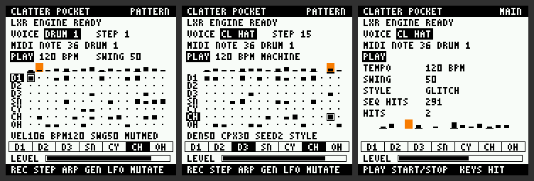

# The CLATTER Pocket sequencer

A 16-step, seven-track drum sequencer with a seeded pattern generator, running in the firmware
on the FM-1's own controls and screen. **Tested on the host and in the FM-1 emulator. Nothing here
has run on a device; the firmware stays UNVERIFIED.**



Left to right: PATTERN playing, the generator's knobs, MAIN.

## To play it

In the emulator ([docs/POCKET-UI.md](POCKET-UI.md)), at 240 MHz: load the package, wait for the
start screen to pass, then:

1. **SEQ** opens PATTERN. A first pattern is already there.
2. **ARP** generates another. **PLAY** starts it.
3. **SELECT** picks a track, **ALGORITHM** a step, **REC** turns the step on or off.
4. **LFO** mutates it, **ENV** undoes the last generate or mutate.
5. **SCL** puts the knobs on DENSITY, COMPLEXITY, SEED and STYLE; **ARP** applies them.

## Controls

On PATTERN:

| Control | Action |
|---|---|
| SELECT | track (the selected voice, the same one SOUND and MIXER edit) |
| ALGORITHM | selected step, wrapping |
| REC | selected step on (velocity 100) or off |
| ARP | **GENERATE**: if a generator setting moved, from those settings; otherwise from the next seed |
| LFO | **MUTATE** the pattern, at the strength on KNOB 4 |
| ENV | undo the last GENERATE or MUTATE; again to redo. One level. Step edits since then go with it |
| SAVE | lock or unlock the track: GENERATE and MUTATE leave it alone. REC still edits it. Nothing is written to Flash |
| SCL | switch the knobs between the step and the generator |

| Knob | Step (default) | Generator (after SCL) |
|---|---|---|
| KNOB 1 | velocity of the selected step, in fours, 1-127 | DENSITY, in fives |
| KNOB 2 | tempo, 30-300 BPM | COMPLEXITY, in fives |
| KNOB 3 | swing, 50-75 % | SEED, 0-9999, wrapping |
| KNOB 4 | mutation LOW, MED or BIG | STYLE, of 11, wrapping |

The legend above the activity cells shows the four fields in knob order.

On every page: **PLAY** starts and stops, the note keys still play the selected voice, and
MIDI still triggers voices. Page buttons, SELECT and MASTER are unchanged. REC, ARP, LFO, ENV,
SAVE and SCL do nothing off PATTERN, so they cannot lose a pattern from another page.

SAFE MODE is untouched: HOME is read once at 1.5 s. The sequencer is not initialised and the
generator never runs in SAFE MODE or after an engine error, and no panel input reaches it.

**Changed from the first interface:** PLAY used to hit the selected voice; it is now the
transport. The 13th note key plays the voice at its programmed pitch, as PLAY did.

## Pattern representation

```c
struct pocket_pattern { uint8_t vel[7][16]; };  /* 0: off, 1..127: on at that velocity */
```

112 bytes, no allocation. There is one pattern. Tempo (integer BPM), swing, transport and the
position live in `seq/pocket_seq.c`; the screens read them from there and keep no copy. Only the
generator's settings, the selected step and the locks are the panel's.

## Timing

`seq/pocket_seq.c`'s `pocket_seq_block` runs in the audio interrupt, at the start of each
64-sample engine block (`pocket_lxr_set_block_hook`), after queued events and before the block
renders. So a step is timed by the audio samples themselves; the screen and the control task
have no part in it.

**Exact integer arithmetic.** Phase is counted in units of 1 / (20 × BPM) of a sample:

| | Units |
|---|---|
| each 64-sample block adds | 64 × 20 × BPM |
| a straight step needs | 300 × rate |
| the first step of a swung pair | 6 × rate × swing |
| the second | 6 × rate × (100 − swing) |

A pair always adds up to two straight steps. What is left over at a step carries into the next,
so nothing accumulates: over an hour at 137 BPM the step count is exactly right (test). The rate
is the output's real one, `FM1_AUDIO_HARDWARE_RATE`, 44,118 Hz. The audio path has no division;
it has one multiply, one add and one compare per block.

**Quantisation.** A step fires at the first block boundary at or after its exact time: never
early, at most 63 samples (1.43 ms) late, and the error does not grow. The LXR's voices cannot
start inside a block: each voice's envelope and filter state is computed per block, and
splitting blocks would change the DSP. The LXR-02 itself triggers at this boundary.

**Tempo and swing changes.** A new tempo applies from the next block and moves no position. A
new swing applies from the next pair, so the pair in progress stays two steps long. The shortest
possible step (300 BPM, swing 75) is 1,103 samples, 17 blocks, so two steps can never fall in one
block.

**Start and stop.** One byte from the control task, read in the next block: step 0 sounds in
that block, at most 1.45 ms after the press is read. STOP silences the next step; voices ring out
as they do after a key press. PLAY always starts from step 0.

## Live editing

The control task and the interrupt share only single aligned words. There are no locks and no
queue, because none is needed:

- **A step edit** is one byte. Ahead of the playhead it is heard this time round; behind it, next
  loop.
- **A whole-pattern change** (GENERATE, MUTATE, undo) is prepared in a second pattern that the
  interrupt is not reading, and published by writing one byte. The next step plays all of the new
  pattern, from the same position; no step can see half of it. The second pattern is also why undo
  costs nothing.
- **Voices** are triggered by the same path as keys and MIDI (`pocket_lxr_trigger_now`, one
  `EV_TRIGGER` applied directly). The event ring keeps its single producer: the block hook does
  not use it.

This relies on the control task and the audio interrupt sharing a core, the same assumption as
the event ring (`POCKET_BARRIER`; HARDWARE.md lists it as an open question).

## Tracks and voices

The LXR has **six voices and seven triggers**, and the sequencer has one track per trigger, in the
order the interface already shows: D1, D2, D3, SN, CY, CH, OH. There is no 10-to-7 track mapping to
hide. Browser CLATTER's ten track roles fold into these the way its default project routes them:

| Track | Trigger | CLATTER's roles |
|---|---|---|
| D1 | DRUM 1 | kick |
| D2 | DRUM 2 | low tom |
| D3 | DRUM 3 | high tom, perc |
| SN | SNARE | snare, clap |
| CY | CYMBAL | cymbal, fx |
| CH | CL HAT | closed hat |
| OH | OP HAT | open hat |

Up to six voices sound on one step, all triggered in the same block.

**Voice sharing:**
- CH and OH are one voice. If both are on a step, the open hat plays and the closed hat does not
  (CLATTER's choke); the generator also never writes both. A closed hat cuts an open one that is
  still ringing.
- They share pitch, filter, drive, level and pan; each has its own decay (SOUND).
- A key or MIDI hit on a voice the pattern is playing restarts that voice.

**Velocity.** The LXR's velocity gain is a per-voice switch (`PAR_VOLUME_MOD_ON_OFF1-6`) that the
init kit leaves off, so without it every velocity sounds the same. It is switched on when the
sequencer starts. Keys send 127, which is unity, so they sound as before. **MIDI velocity is now
audible too**, as FIRST-HARDWARE-TEST.md already expected.

## Generation

`seq/pocket_gen.c` is a port of CLATTER's `src/rhythm/generate.ts`, in integer arithmetic, with
CLATTER's 11 styles (`seq/pocket_styles.h`, generated from `styles.ts` by
`tools/gen-seq-styles.py`). It does not draw each step independently. Each role has a **lane**, a
chance per step that says what that role is for, and the lanes are shaped by metric position:

- **Kick** anchors: lanes put certainty on the strong beats, and step 0 is kept.
- **Snare** accents: strong backbeat digits, ghost notes in the weak positions of some styles.
- **Hats** subdivide, with velocity following the beat.
- **Toms and percussion** vary: sparse lanes, and fills into the end of the bar, high toms first.

| Setting | Effect |
|---|---|
| **DENSITY** | An exponent on every chance (`1 − (1 − p)^(1/k)`, a table here), so certain steps stay and weak ones come and go. 50 is the style as written |
| **COMPLEXITY** | Moves weight off the beat: pickups where a lane is silent, mostly just before a strong beat; written weak steps loosened; ghost notes; more fills |
| **SEED** | Every decision is a keyed hash of (seed, purpose, track, step). The same settings give the same pattern on any platform, and raising DENSITY adds to a rhythm rather than drawing another |
| **STYLE** | MACHINE, ELECTRO, BREAKS, JUNGLE, HALFTIME, BROKEN, GARAGE, INDUSTRIAL, GLITCH, POLYMETER, DUB. The last-but-two and last-but-one use Euclidean lanes: cross-rhythms that do not fit the bar |

Then rules across tracks (`arrange`): hats choke; the kick clears a strong backbeat where the
style says so; toms keep off the kick; a pattern is never empty.

**Added for Pocket.** CLATTER gets its variety from phrases of several bars; here the phrase is
one bar. So above 60 % COMPLEXITY supporting tracks are displaced by a seeded rotation, and above
80 % the closed hats become a Euclidean figure of 5, 7, 11 or 13 and the kick loses its anchor.
That is the experimental end. Below that, a pattern is recognisably its style.

**Not ported:** VARIATION and multi-bar phrases (one bar), per-step probability and conditional
trigs (the step format has only velocity), per-style tempo and swing (GENERATE changes the pattern,
never the tempo).

Patterns are **not** byte-compatible with CLATTER's for the same seed: the hash's inputs and the
arithmetic differ. Compatibility is with its musical rules.

## Mutation

Also in `seq/pocket_gen.c`, a port of CLATTER's `src/rhythm/mutate.ts` (itself adapted from
DOWNBEAT's EXTENDED mutation, MIT). It applies a short list of musical edits to a copy of the
pattern, so the result stays related to what was there.

| Strength | Edits, for about 28 hits | Edits allowed |
|---|---|---|
| LOW (0.2) | about 2 | add, remove, shift, velocity, accent, swap |
| MED (0.5) | about 7 | also density and rest runs |
| BIG (0.85) | about 14 | also recombining beats, rotating and reversing |

Edits prefer weak metric positions at low strength, so the anchors stay: removing a strong loud
hit needs more than MED. Each press uses the next value from (seed, count), so it is deterministic
and each press differs. An edit that finds nothing to do (a shift onto a hit) is drawn again, so
a press changes something: without this 1 press in 10 did nothing at LOW.

Tracks locked with SAVE are never touched, by either operation. The lock is per track; there is
no per-step protection.

## Size

Measured from the link map and the SDK's firmware report, against the interface build:

| | Interface | Sequencer | Change |
|---|---|---|---|
| App image | 423,100 | **430,908** | +7,808 |
| Headroom under 453,921 | 30,821 | **23,013** | |
| `.ram0_data` (SRAM code and data) | 104,924 | 105,756 | +832 |
| `.ram0_bss` | 284,588 | 284,876 | +288 |
| Runtime heap (SDK minimum 49,152) | 134,028 | **132,908** | −1,120 |

| Where the 7,808 went | Bytes | Placement |
|---|---|---|
| generator, mutation, 11 styles, density table | 5,011 | Flash, `-Oz` |
| panel: the editor | 1,932 | Flash, `-Oz` |
| sequencer clock | 686 code and data, 268 bss | SRAM |

The flash layout, bootloader, updater, Bluetooth and packed tables are unchanged, and
`tools/check-firmware.py` passes, including its 16,384-byte margin for hardware fixes. The
sequencer allocates nothing.

**Stack**, from the frames in the linked ELF (the JieLi compiler has no `-fstack-usage`):

| Path | Bytes |
|---|---|
| `pocket_gen_generate` | 152 |
| `pocket_gen_mutate` | 188 |
| `pocket_panel_apply`, mutating | 228 |
| `pocket_panel_draw_band` | 268 |
| `groove_screen_control` to the panel | 444 at most |
| audio interrupt: `pocket_seq_block` adds 24, the trigger path 16 | 440 at most |

The control path stays under the 720 bytes the audit found (engine start), of an `app_core` stack
of 2,048 units. The audio figure is the audit's 400 plus those frames. **The audit's "no indirect
calls" no longer holds on the audio path:** the hook and the voice trigger are two function pointers,
both set before audio starts and both targets checked to be in SRAM by `tools/check-firmware.py`.

**CPU**, in the emulator at 240 MHz: 28.1 % mean stopped, 28.2 % mean and 28.5 % peak playing. The
engine's load is fixed, so the sequencer adds little. **This is not a device measurement**: the
emulator counts about one instruction per cycle and models no cache or Flash wait states.

## Tests

| Command | Covers |
|---|---|
| `make test` | `test_seq`, 13,309 checks with AddressSanitizer and UBSan: every step of 8 tempos × 5 swings × 2 rates against exact arithmetic, an hour without drift, swing ratios, tempo and swing changes mid-pair, loops, transport, simultaneous triggers and the hat choke, live edits, atomic pattern changes, undo, boundaries, seed determinism (including a fixed hash), every style × density × complexity × 8 seeds, role behaviour, density and complexity effects, locks, mutation strength and limits |
| | `test_panel`, 144 checks on the real engine: the sound starts where the clock says, every track's velocity is heard in the rendered audio, voices end after STOP, the whole control scheme, nothing acts off PATTERN |
| `make emu-test EMU_WASM=…` | `tools/emu-test.mjs`, 93 checks, below |

All of the engine, panel, MIDI, libm and table checks still pass, and the comparison script renders
bit-identical voices between configurations. `pocket_lxr_render_q23` is unchanged with no hook set.

### Emulator results

The package below, the emulator's WebAssembly core (master `93cb7ee`), 240 MHz, **93 of 93 checks**.
Onsets come from the emulated audio output, the grid and playhead from the LCD's pixels, and all
input from the emulated panel.

| Check | Result |
|---|---|
| 1. Boots | start screen, engine ready, no stock text; the stock package fails the identity check |
| 2. PATTERN displays the grid | read from pixels; **identical to the host's seed 1, bit for bit** |
| 3. PLAY repeats | 10 of 10 onsets recur exactly one loop (88,236 samples) later |
| 4. STOP | no onsets after, silent, playhead gone |
| 5. Playhead | 16 of 16 positions seen in 40 samples of the screen |
| 6. Step edits | all steps cleared and written by the controls alone; edits while playing heard: eighths at 11,024.0 samples (11,029.5 exact) |
| 7. Tempo | 120 BPM: a beat is 22,067.2 samples (22,059 exact), range 22,017 to 22,080. 180 BPM: an eighth is 7,355.4 (7,353 exact) |
| 8. Swing | straight 5,516.8 samples (5,514.75 exact); swing 66 is 7,296.0 (7,279.5 exact) |
| 9. GENERATE | identical to the host's next seed; density, complexity, seed and style all reach it (GLITCH, seed 42, matches the host) |
| 10. MUTATE | 4 to 7 steps changed per press at MED, pattern recognisable; undo restores |
| 11. SOUND and MIXER | each edits while the sequence plays |
| 12. MIDI | DIN MIDI triggers over the sequence |
| 13. Diagnostics | SYSTEM live; 0 overruns and 0 dropped, including 20 s of the sequence with hits through it |
| 14. SAFE MODE | HOME at start-up: silent, PLAY starts nothing |

The audio errors above are within the emulator's 128-frame output blocks: the host tests are what
show the 64-sample bound.

**Not shown by any of this:** real timing, the real display, encoder direction and acceleration,
or how it sounds on the device. USB MIDI and BLE were not run (the emulator raises no USB
controller interrupt). The update path was not exercised, though it is unchanged. Musical quality
was checked by rule and by reading patterns, not by ear: the checks show the rhythms obey their
roles, not that you will like them.

## Known limitations

- **Nothing is saved.** A restart gives seed 1's pattern at 120 BPM. Storing patterns needs user
  Flash code, which this firmware deliberately has none of (ROADMAP C).
- One pattern, 16 steps, 16th notes. No chaining, no track lengths.
- Steps have velocity only: no per-step pitch, probability or parameter locks, though the engine
  has locks (`pocket_lxr_trigger_locked`).
- Timing resolution is the 64-sample block, 1.45 ms.
- No MIDI clock in or out, and no MIDI note output.
- Undo is one level, and a step edit since the last GENERATE or MUTATE goes with it.
- Swing is by pairs of steps, on 16ths.
- An amp decay of 127 on SOUND never ends and 126 lasts minutes: LXR firmware behaviour
  (`test_long_decays`), the same after a key press. STOP does not mute voices, so such a voice
  keeps sounding until something else changes it.
