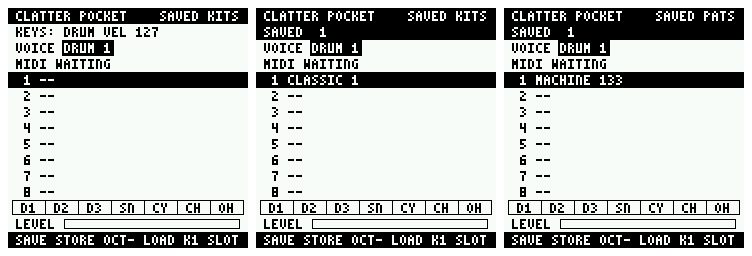

# Saving kits and patterns

CLATTER Pocket saves 12 kits and 12 patterns in the FM-1's user Flash, and they survive a restart.


**Tested on the host, on a model of the Flash chip, and in the FM-1 emulator. Nothing here has run on
a device, and a device's Flash is the one thing an emulator cannot stand in for: read
[What is not known](#what-is-not-known). The firmware stays UNVERIFIED.**

## To use it

Hold **SAVE** and press **EDIT** for the saved kits, or **SEQ** for the saved patterns. In the browser
emulator that is `8` with `5`, or `8` with `0`.

| On the page | |
|---|---|
| KNOB 1 | choose a slot |
| **SAVE** | store here. On a slot in use it asks first: press again while OVERWRITE: SAVE AGAIN shows. Only when stopped: STOP TO SAVE otherwise |
| **OCT−** | load this slot, also while a pattern plays |
| anything else | as everywhere: the keys, PLAY, ENV, ARP, LFO, the page buttons |

A load can be undone like anything else that replaces a sound or a rhythm: SAVE+OCT+ for a kit,
SAVE+OCT− for a pattern. Factory kits are not slots and cannot be overwritten: they are generated, not
stored.

| Saved in a kit | Saved in a pattern |
|---|---|
| all 246 sound parameters: every voice, levels and pans | every step: velocity and recorded pitch |
| which factory kit or character it came from | tempo and swing |
| its seed and WILD, and whether it was hand-edited | DENSITY, COMPLEX, SEED, STYLE, MUTATE, the track locks |

The tempo is part of the pattern, so loading one changes it. The kit is not: a pattern can be played
with any kit.

## Is it safe to write to this device's Flash?

Conditionally, and that condition is what the design is built around. The firmware had no code that
could touch the user partition (FM1-REPLACEMENT.md), on purpose, until this audit.

### What exists

| Question | Answer | Source |
|---|---|---|
| A storage API? | Yes: `fm1_flash_size`, `_read`, `_write`, `_erase`, for the control task, at 4 KiB sectors. Not transactional: it says to use CRC, versions and two sectors | `sdk/include/fm1.h` |
| A file system? | No. Raw sectors. The SDK's VM holds its own settings and is not for applications | HARDWARE.md, PRE-FLASH-AUDIT.md |
| How much? | 536,576 bytes, 131 sectors | package `USER` record |
| Does the running firmware have data there? | **No**, but it is not free: see below | |
| Survive a restart? | Yes: it is NOR Flash | |
| Survive a firmware update? | By design: an update writes `flash.bin`, 0 to the end of the image, and these sectors are past it. **Not proven**: the vendor loader's erase behaviour is undocumented, and M-VAVE warn migration can erase user data | `Package.cs`, `WebUpdate.js`, HARDWARE.md |

### Who owns what

The stock fm1_open layout claims the **whole** partition: there is no unused area to move into.

```
0x7C000  USER starts
         projects, settings, staging    17 sectors    stock Open     not touched
0x8D000  sample area                                  stock Open
           ...                                        V15's VM, 0x93000..0xE9000
0xE5000    CLATTER POCKET: 4 sectors                  <- here
0xE9000    V15's BTIF                                 not touched
0xEA000    the vendor's USR area, to 0xFC000:         not touched
           FACTORY VOICES, which updates leave alone
0xFA000    Open's DX7 library, 4 sectors              not touched
0xFE000    Open's tuning, 1 sector                    not touched
0xFF000  key_mac                                      not touched
```

**The vendor's USR area is the finding that matters.** It is inside what stock Open calls the sample
area, no package declares it, and real units carry the factory bank there, because updates do not
write it (fm1-emu's `docs/stock-firmware.md`, and its V15 boot, which shows data at 0xEE000 and 0xFA000).
The first sectors chosen for this work were inside it, just under Open's library. They were blank in
the emulator. A blank-sector test alone would have passed them.

**0xE5000..0xE8FFF** was chosen because it is:

- below all of the vendor's USR area, and BTIF;
- above stock Open's projects, in space it uses only for a sample bank over 360 KB;
- the far end of V15's 352 KB VM, which an idle V15 run in the emulator does not reach;
- a place stock Open already expects to find data it does not recognise: it erases every sector
  before it writes a sample there (`samples.c`), so a later bank takes the sectors and costs nothing
  but our saves, and nothing in it ever reads past its own bank.

### The rules the code keeps

1. **Nothing happens until asked.** No Flash access at start-up, in SAFE MODE, or at all until a save
   page opens. `check-firmware.py` and the emulator tests hold this.
2. **Only blank or ours.** Opening a store reads all of both sectors. Anything that is neither all
   0xFF nor carrying our magic number closes that store: `FLASH IN USE: SAVING OFF`, and those sectors
   are never erased or written. Saving stays off on such a device; the instrument is unaffected.
3. **The partition must be exactly the expected size**, or no sector here means what it should.
4. **A sample bank reaching these sectors closes the store**, because a sample can contain a blank
   sector, so blank is not proof of free.
5. **The sector last written is never the one erased.** See below.
6. **Saving only when stopped.** Erasing a sector silences audio for its length, and that is not
   worth a dropout in a performance. Loading writes nothing, and works while playing.

### What a save does

Each store is a bank: 12 slots of 256 bytes and a 32-byte header, 3,104 bytes, in a pair of sectors.

1. Erase the sector that does not hold the current bank (unless it is blank).
2. Write the whole bank to it, with the commit word left erased.
3. Read it all back and check its CRC.
4. Write the commit word.
5. Read it back again.

The bank opened is the committed one with a good CRC-32, right version and the highest generation. So
at every moment there is a whole bank on the chip, and **a power cut can lose only the save in
progress**. A bank is whole or not used: a corrupt newest bank means the one before it, one save
older. If both are bad, the page says SAVED DATA DAMAGED, lists nothing, and saving still works.

A sector that is not ours is only ever overwritten in one case: it is the partner of a good bank of
ours, which is what a save cut off in its erase looks like. The first save found that sector blank or
ours, and rule 4 is what would have shown anyone else taking it since.

Values loaded are range-checked as well: a good CRC says what was written, not that it is sensible.

Each save erases one sector, alternating between two, so 100,000-cycle Flash gives about 200,000
saves per store.

### The audio path

**Found by this audit, and fixed.** Flash cannot be read while it is being written, so anything the
audio interrupt can reach must be in SRAM. The audio path called `memset`, which was in Flash: the
compiler makes clearing loops into calls to it. The emulator cannot show that: it does not stall
fetches. `fm1_flash_write` and `fm1_flash_erase` do suspend audio, but that is not something to depend
on when it can be removed. `memset` is now in SRAM, with no change to the image, and `tools/check-audio-path.py`
walks the linked firmware from the audio entry points: 54 functions, none leaving SRAM. The firmware updater's writes benefit in the same way.

## Testing

| | |
|---|---|
| `test_store` | 1,379 checks with AddressSanitizer and UBSan, on a model of the chip whose programming only clears bits. **A power cut at every operation of a save, from four different histories**, each half-finishing that operation as `fm1-emu`'s FM1_FLASH_CUT does: always the old bank or the new, whole; nothing outside our sectors changes; it saves again after. Foreign bytes at every position refused without a write. A bit flipped through the bank in both sectors. Flash reporting failure |
| `test_panel` | 387 checks in all: the save and load flows by the panel's own controls, on the real engine: every parameter returns, overwrite protection, STOP TO SAVE, undo, restart, out-of-range records, the pages when saving is off |
| `tools/emu-test.mjs`, storage | the firmware's real writes to the emulated chip. Below |
| `tools/check-audio-path.py` | nothing the audio interrupt reaches is in Flash |

In the emulator, what is checked is the actual firmware through the SDK's real Flash driver:

- using the instrument changes no sector of the user partition;
- save a kit, change its sounds, load it: SOUND shows the same values;
- save a pattern with a recorded note, tempo and swing, generate another, load it while it plays;
- **restart the machine with the chip's contents, and load both back**;
- only our four sectors changed in the user partition; factory-like data placed at 0xEE000 and 0xFA000
  is intact; nothing in the vendor's USR area changed;
- a corrupted bank, an erase cut half way, a save cut before its commit: the last whole bank stands;
- both banks corrupted: SAVED DATA DAMAGED, nothing loads;
- another owner's data in our sectors, and a stock sample bank over them: saving goes off, the sectors
  are unchanged;
- SAFE MODE: the save controls do nothing and nothing is written.

The emulator's own power-cut option is not reachable from its WebAssembly core, so its interrupted
states are constructed, from what the host model produces.

## What is not known

**None of this has run on a device.** The emulator's chip is an accurate model of a NOR part with
instant erases and programs; a real one is slower, and its power-cut behaviour is not half a page.

- **Whether these four sectors are blank on your unit.** If a unit's history left anything there,
  saving turns itself off and says so. That is the safe failure, and nothing can be said for sure
  until a device is looked at.
- **Audio during an erase.** The SDK says it is silenced. How long, and how it sounds, is unmeasured.
- **Whether the vendor's loader leaves these sectors alone** on updates, and on migrating to V15 or
  Open. Keep nothing here you cannot afford to lose; there is no export.
- **What V15 does with data in the far end of its VM area** after a return to it. It would be the same
  as what a large Open sample bank leaves there. Unverified, as PRE-FLASH-AUDIT.md's VM section is.
- **Unit-to-unit differences.** The USR area's extent is documented for V13 and V15 by the emulator's
  author and in `WebUpdate.js`, not by M-VAVE.
- The browser emulator keeps Flash per package, by its hash: a new build starts with no saves.

FIRST-HARDWARE-TEST.md has the first device check, as its own step, after everything else.

Cost: 3,168 bytes of Flash and 3,616 of RAM, most of it one bank's buffer. A save's stack is 604 bytes
to the SDK's driver. `tools/check-firmware.py` holds the placement.
