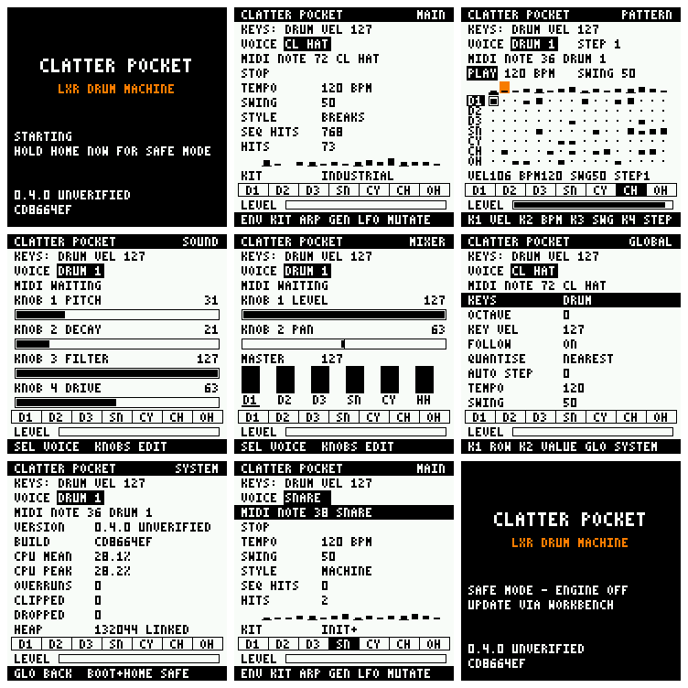

# The CLATTER Pocket interface

The interface on the FM-1's own screen and controls. It is the real firmware's, not a
mock-up: the screens below were read from the LCD of the emulated FM-1 running the package.
**Nothing here has run on a device; the firmware stays UNVERIFIED.**

Top row: start screen, MAIN, PATTERN. Middle: SOUND, MIXER, SYSTEM. Bottom: a MIDI hit, SAFE
MODE, and the stock fm1_open package for comparison.

## Why the first report showed the stock interface

**The cause is not proven.** The firmware was not at fault: the package from commit `b3092fe`
(`b8c13d2c…`) shows CLATTER Pocket in the emulator, and it did from the first run.

| Loaded into the emulator | Result |
|---|---|
| `b3092fe` package, `fm1-emu --fwsc` (native) | CLATTER Pocket, engine ready |
| same, the deployed page's WebAssembly build, clean browser profile, default 100 MHz | CLATTER Pocket |
| same, with the page's "M-VAVE stock firmware" entry selected | CLATTER Pocket, though the page calls it M-VAVE's |
| `fm1_open-stock-4c7496d.fwsc`, the stock build next to it | **the stock interface** |
| nothing: the page's default | **Felucca**, an FM synth |

Reading the emulator's source and running it rules out the other explanations:
- it runs the package's `app.bin` on an emulated CPU, for every firmware, including
  replacement applications; there is no special case for stock (`fm1_soc::stock_from_package`);
- it loads the whole package; flash and the last package are kept in the browser's IndexedDB,
  keyed by the package's hash, so one package's state cannot appear under another;
- its LCD, keys, encoders, MIDI in and I2S work with this firmware.

So the screen that was seen came from some other package. The likely route: the build left
two packages of **exactly the same size** (492,084 bytes, the layout padding) in sibling
folders, and two identical file names, `tree/build/dx7/generated/FM1_OFFICIAL_OPEN.fwsc`, one
of each. Starting the page before opening a file, which boots Felucca, also fits. Which
happened cannot be established from here.

What changed as a result:
- the build **moves** the package to its named file, so `FM1_OFFICIAL_OPEN.fwsc` no longer
  exists and the only CLATTER Pocket package has CLATTER in its name;
- the start screen is unmistakable;
- `tools/emu-test.mjs` runs the stock package as a negative control.

The display code never needed fixing. Start-up, as read from the ELF, is
`groove_screen_init` (the SDK calls it, and the application provides it) → `fm1_update_init` →
`fm1_io_start` → `fm1_audio_start`, then `groove_screen_control` on each poll. The SDK has no
screen of its own: the stock UI is `app/screen.c`, which the replacement build removes.

### To load it

1. Open https://joakimeriksson.github.io/fm1-emu/ and set Clock to **240 MHz** (the real
   clock; the page starts at 100, where the CPU figure is 2.4 times higher).
2. **Open .fwsc…** and choose `build/fm1-replace/clatter-pocket-fm1-replace-UNVERIFIED.fwsc`.
3. Press **Start**. The heading names the file; the screen says CLATTER POCKET.

If M-VAVE's entry is selected, the page files the package under that name and replaces any
copy of M-VAVE's firmware it had kept: select another entry first.

## Display

240 × 240, RGB565, ST7789-class. The stock UI's own method is kept:
- the screen is 15 bands of 240 × 16; a page is drawn one band at a time into one 7,680-byte
  buffer and sent with `fm1_screen_blit`;
- each band has a dirty bit; at most 4 bands are sent per control poll, and none while a
  transfer is pending;
- a 3 × 5 font at 2× (3× for the title), no images, no allocation; a line holds 28 characters.

`ui/pocket_panel.c` is platform-independent; the same code runs in the host tests.

| Bands | Content |
|---|---|
| 0 | CLATTER POCKET, page name |
| 1 | engine state; AUDIO OVERRUN n, inverted, for 3 s after an overrun |
| 2 | selected voice |
| 3 | MIDI: WAITING, MESSAGES n, or NOTE n and the voice, inverted for 200 ms after a hit |
| 4 to 11 | the page |
| 12 | seven activity cells, inverted for 120 ms on a trigger |
| 13 | output level meter |
| 14 | what the controls do here |

Before the engine runs, and in SAFE MODE and on an engine error, the whole screen is the
start screen: CLATTER POCKET, LXR DRUM MACHINE, the state, the version and the build.

## Controls

Encoder positions come from the emulator's panel (Felucca's `controls.jpg`) and fm1_open's use
of them. They are not checked on a device.

| Control | Action |
|---|---|
| SELECT | selected voice, on every page: DRUM 1-3, SNARE, CYMBAL, CL HAT, OP HAT |
| note keys | play the selected voice chromatically (the 13th key is its programmed pitch) |
| PLAY | start or stop the sequencer, on every page |
| OCT− / OCT+ | previous / next page, wrapping |
| HOME | MAIN |
| SEQ | PATTERN |
| EDIT | SOUND |
| FX | MIXER |
| GLO | SYSTEM |
| KNOB 1-4 | SOUND: PITCH, DECAY, FILTER, DRIVE. MIXER: LEVEL, PAN. PATTERN: POCKET-SEQUENCER.md. Elsewhere nothing |
| MASTER | output level (the pot, as stock) |
| HOME held 1.5 s after power-on | SAFE MODE |

PATTERN adds its own controls: ALGORITHM, REC, ARP, LFO, ENV, SAVE, SCL and the knobs, in
[POCKET-SEQUENCER.md](POCKET-SEQUENCER.md). They act only on PATTERN. PRESETS does nothing. **No
control writes Flash or updates anything**; the one thing a control can lose is the pattern, and ENV
undoes that. The earlier "ENC 1/2/3" and "ENC 7" labels were matrix indices: they were
physically SELECT, ALGORITHM, KNOB 1 and PRESETS.

SAFE MODE is unchanged: HOME is read once, at the 1.5 s point, and a button held then does not
act afterwards. So HOME's page function cannot reach SAFE MODE, or the reverse.

## Pages

- **MAIN**: transport, tempo, swing, style, hits from the sequence and from the keys, and a row
  showing how many tracks play each step, with the playhead.
- **PATTERN**: the step editor. Line 1 is the transport, tempo and swing (or the style); then a
  ruler of the same activity row with the playhead and the selected step; then seven rows of 16
  cells, bars as tall as their velocity; then the four knobs' fields. All 16 steps fit, 12 pixels
  each, with the beats set apart, so there is no paging. The playhead has a band to itself, so a
  step redraws one band, not the grid.
- **SOUND**: four parameters of the selected voice: COARSE, velocity decay, filter frequency,
  and drive (DRIVE1-3, or the snare, cymbal and hat distortion). The hats share pitch, filter
  and drive; each has its own decay.
- **MIXER**: LEVEL and PAN of the selected voice, MASTER (shown; set by the pot), a level bar
  per voice. The LXR's pan is taken at each trigger, so a move is heard on the next hit.
- **SYSTEM**: version, build, CPU mean and peak, overruns, clipped samples, dropped events,
  heap.

SYSTEM's heap is **the size given to the heap at link time** (`_HEAP_END − _HEAP_BEGIN`),
labelled LINKED. The SDK has no call for what is free.

## Audio and MIDI feedback

`clatter_pocket_render` is unchanged. The sequencer's clock runs inside the engine's render, at
the start of each block (POCKET-SEQUENCER.md).
- Trigger feedback comes from the control task, which sends the key triggers and reads which tracks
  the sequencer played. The screen follows the audio; it never drives it.
- MIDI: the routing task queues trigger, velocity and note; the control task starts the voice
  and updates the screen at once.
- The level meter, CPU, overruns, clipped and dropped are the existing diagnostics, read twice
  a second with interrupts held.

So there is no per-voice level measurement: the cells show triggers, the meter the sum.

## Tests

| Command | Covers |
|---|---|
| `make test` | `test_seq` and `test_panel`, on the real engine: the sequencer (POCKET-SEQUENCER.md), navigation, wrapping, unassigned buttons, knob scope, selection, clamping, **every control of every voice changes the rendered audio**, pan direction, MIDI and audio activity, the overrun warning, redraw masks, every band of every page in every state stays in its buffer |
| `make emu-test EMU_WASM=…` | `tools/emu-test.mjs`: the package in the emulator (below) |
| `python3 tools/check-firmware.py` | size and headroom, heap, stock layout, SRAM and Flash placement, no user-flash code, from the ELF |

### Emulator results

93 checks pass, on the package in FM1-REPLACEMENT.md, in the emulator's WebAssembly core (master `93cb7ee`) at
240 MHz: start screen, no stock text, silence until played, every page by its button and by
OCT−/OCT+, the seven voices, key audio, parameter editing, DIN MIDI to the voice and
the screen, SYSTEM figures, the sequencer with measured timing (POCKET-SEQUENCER.md), 20 s of the
sequence with hits through it, without a reset, SAFE MODE silent with the engine off, and the stock
package failing the identity check.

Limits of what this shows:
- **Not run:** USB MIDI (the emulator's controller raises no interrupt yet) and BLE.
- **The CPU figure, 28.2 % playing, is not a device measurement.** The emulator counts about one
  instruction per cycle and models no cache or Flash wait states.
- The firmware update path was not exercised.
- Timing, the real screen, knob directions and sound are for the hardware test.

## Limitations

- PRE-FLASH-AUDIT.md audited commit `b3092fe`. Its worst-case stack figures were not recalculated
  for this interface; the safety properties are rechecked by `tools/check-firmware.py` and the
  emulator run, and the bootloader, update identity, flash layout, engine and audio path are
  unchanged.
- Parameters and patterns are not saved; a restart returns to the init kit and seed 1.
- One parameter set per page: the other LXR parameters are reachable only from CLATTER's
  engine API.
- Velocity is fixed at 127 from the keys (the scanner reports on and off). Steps and MIDI have
  velocity.
